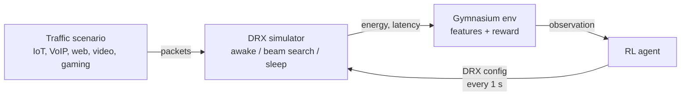
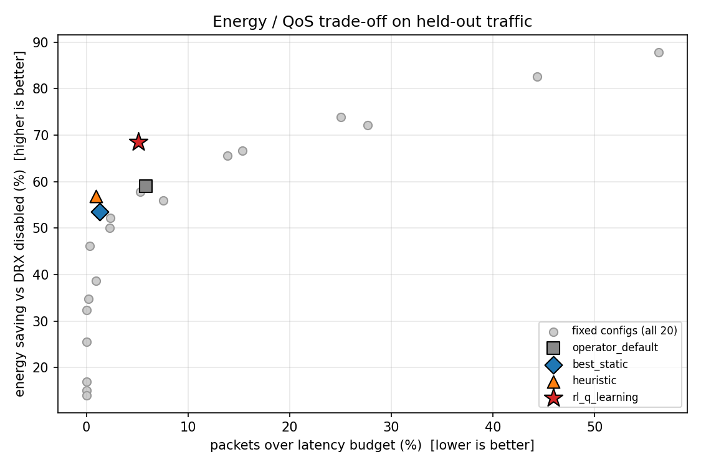
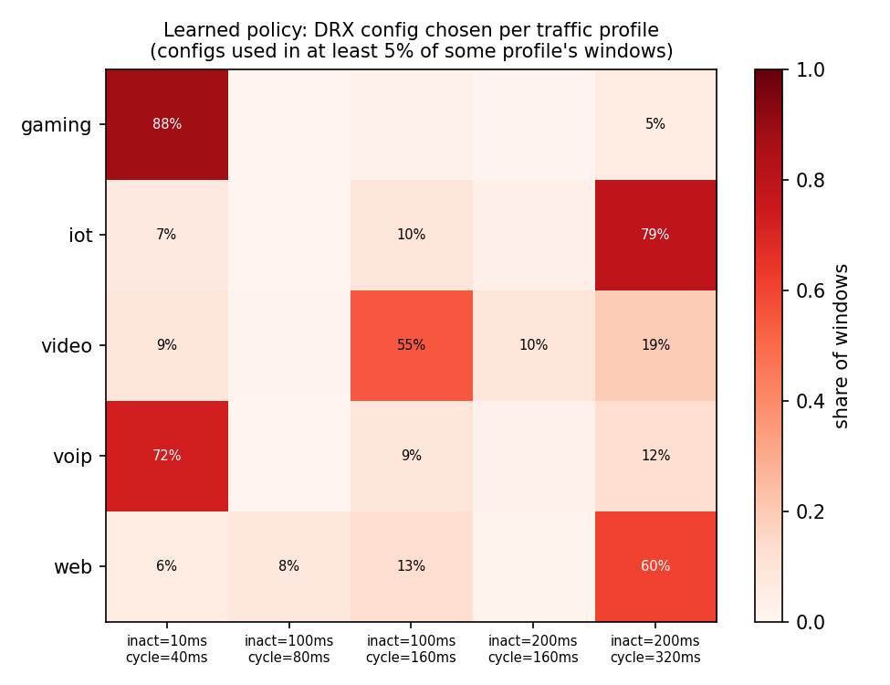

# drx-rl-optimizer

**Reinforcement learning for energy-efficient DRX configuration in 5G mmWave networks.**


A phone saves battery by sleeping between bursts of data. 5G's Discontinuous Reception (DRX) controls how long it stays awake after data arrives (the *inactivity timer*) and how often it wakes up to check for more (the *cycle*). Sleep too eagerly and packets wait, breaking latency budgets. Stay awake too long and the battery drains.

At mmWave frequencies this trade-off gets harder: the phone must **re-align its beam every time it wakes up** before it can receive anything, so every wake-up carries a fixed energy and latency overhead. And the right setting depends on what the user is doing: a VoIP call, a game, a video stream, and an idle IoT sensor each want something different.

This project builds a simulator of that problem and trains an RL agent that picks the DRX config every second based on observed traffic, then benchmarks it honestly against fixed configs and a hand-written heuristic.

## Highlights

* **vs. the operator default (mmWave):** 68.6% vs 58.9% energy saved, *and* fewer late packets (5.1% vs 5.8%). RL beats the default on both axes at once.
* **Tunable trade-off:** one reward weight (lambda) moves the agent from "maximum battery" to "strict QoS" (0.8% late packets).
* **A debugging story:** the first agent failed under strict QoS. I traced the failure to *partial observability* (a paused VoIP call and an idle IoT sensor look identical within one window) and fixed it with history features, cutting VoIP violations from 7.5% to 1.0%.
* **Engineering:** event-driven simulator, Gymnasium environment, 143 tests at 98% coverage, a conservation invariant that caught a real bug, CI on three Python versions, reproducible seeded experiments.

## Quick start

```bash
git clone https://github.com/sriyaamperayani/drx-rl-optimizer
cd drx-rl-optimizer
pip install -e ".[dev]"

make test                                       # 143 tests, about 10 s
drxgym experiment --out runs/fr2_lambda2        # train + evaluate + figures, about 2 min
drxgym experiment --beam-search-ms 0            # sub-6 GHz (FR1) ablation
drxgym inspect runs/fr2_lambda2/q_table.npz     # print the learned policy
```

## How it works



* **Simulator:** an event-driven model of connected-mode DRX. After data the UE stays awake for the inactivity timer, then cycles between sleep and short on-durations. On mmWave each wake-up starts with a 4 ms beam search. Packets arriving during sleep wait for the next on-duration. Sleep depth (micro, light, deep) is chosen per gap based on transition costs, using relative power values in the style of 3GPP TR 38.840.
* **Traffic:** five profiles with their own latency budgets (gaming 40 ms, VoIP 50 ms, web 150 ms, video 400 ms, IoT 2 s). The user switches between them as a Markov chain, so no single fixed config is right all the time.
* **Agent:** tabular Q-learning over 20 actions (inactivity timer in {10, 50, 100, 200} ms by cycle in {20, 40, 80, 160, 320} ms). Reward = -(normalized energy) - lambda x (fraction of late packets).
* **Evaluation:** 200 held-out episodes (12,000 simulated seconds). Every policy sees the *identical* packet trace.

Full details, assumptions, and design decisions: [docs/DESIGN.md](docs/DESIGN.md).

## Results

### mmWave (FR2, 4 ms beam search), lambda = 2

| Policy | Energy saving | Late packets | Mean latency | p95 latency |
|---|---:|---:|---:|---:|
| Operator default (100 ms / 160 ms) | 58.9% | 5.84% | 30.2 ms | 132.6 ms |
| Best fixed config, chosen with hindsight | 53.5% | 1.32% | 25.9 ms | 131.2 ms |
| Hand-written heuristic | 56.8% | 0.92% | 18.2 ms | 61.8 ms |
| **RL agent** | **68.6%** | 5.14% | 45.6 ms | 189.7 ms |

Energy saving is relative to DRX disabled (always awake). "Best fixed config" is tuned on the evaluation traces themselves, an advantage given deliberately to make it a hard baseline.



### What the agent learned



The learned behavior matches wireless intuition. Gaming and VoIP, with tight budgets, get a short 40 ms cycle. IoT and web get a long 320 ms cycle with a long 200 ms inactivity timer: sleep deeply when idle, but once a burst starts, stay awake through it instead of paying beam search again for every packet. Video mostly gets a middle setting. None of this was programmed in.

### Stricter QoS (lambda = 5) and sub-6 GHz (FR1)

| Setting | Policy | Energy saving | Late packets | Return |
|---|---|---:|---:|---:|
| mmWave, lambda = 5 | Heuristic | 56.8% | 0.92% | **-29.08** |
| | RL agent | 54.9% | **0.79%** | -29.77 |
| FR1, lambda = 2 | Heuristic | 65.8% | 0.82% | -22.03 |
| | RL agent | **71.3%** | 3.12% | **-20.26** |

The cost of beam search shows up directly: the same heuristic saves 65.8% on FR1 but only 56.8% on mmWave. Nine points of battery go to re-aligning beams.

### Robustness across training seeds (mmWave)

| lambda | Return | Energy saving | Late packets | Heuristic return |
|---:|---:|---:|---:|---:|
| 2 | -23.74 ± 0.64 | 68.6% ± 0.3 | 5.27% ± 1.06 | -27.75 |
| 5 | -30.12 ± 1.06 | 54.7% ± 2.5 | 0.91% ± 0.27 | -29.08 |

Mean ± standard deviation over three training seeds on the same 200 held-out episodes.

### Honest summary

* When battery matters more than a few late packets (lambda = 2), RL **reliably** beats every baseline on mmWave (all three training seeds) and also wins on FR1 (single seed).
* Under strict QoS (lambda = 5), RL reaches the lowest violation rate but **does not beat** the hand-written heuristic on the combined objective; the heuristic wins on all three seeds by a small margin. With only last-window statistics plus two averages, the agent cannot predict when a burst will start, and that is where a well-chosen rule of thumb stays competitive.

## The partial observability bug

The first version of the agent observed only the previous window. Under strict QoS it produced 7.5% late VoIP packets versus 0.35% for the heuristic, and raising lambda barely changed that.

Diagnosis: during a VoIP *silence*, a window has zero packets, exactly like an idle IoT sensor. The agent learned "empty window means short inactivity, long cycle" (ideal for IoT, web, and video), so when speech resumed mid-window, VoIP packets missed their 50 ms budget for the rest of that second. The heuristic avoided this by accident: its 50 ms inactivity timer keeps the phone awake through a 20 ms VoIP stream once the first packet arrives.

Fix: two slow exponential averages (recent activity, recent periodicity) give the agent memory. A dedicated test checks that over 70% of paused-call windows now map to different states than idle-device windows. VoIP violations dropped from 7.48% to 1.02%, and overall violations at lambda = 5 from 3.93% to 0.79%.

## Project structure

```
src/drxgym/
  config.py       power model, radio timing, DRX configs, action grid
  traffic.py      traffic sources and Markov-switching scenario
  simulator.py    event-driven DRX simulator
  env.py          Gymnasium environment
  agents.py       baselines and Q-learning
  evaluation.py   paired evaluation harness
  experiment.py   end-to-end pipeline
  plotting.py     figures
  cli.py          command-line interface
tests/            143 tests (unit, invariant, regression, end-to-end)
scripts/          seed robustness study
runs/             committed results for the three reported experiments
docs/DESIGN.md    architecture, model, and design decisions
```

## Limitations and next steps

The model is intentionally simple. It uses one long DRX cycle (no short cycle, wake-up signal, or PDCCH skipping), a fixed beam-search overhead, a single UE, synthetic traffic, and relative energy units. Natural next steps:

1. **Validate against a full-stack simulator** (ns-3 with 5G-LENA) to check that the relative rankings hold.
2. **Mobility-dependent beam search**, where faster movement means longer re-alignment.
3. **Deep RL** (DQN or PPO via Stable-Baselines3) with longer observation history, aimed at the strict-QoS regime where the tabular agent ties the heuristic.
4. **Real traffic traces** instead of synthetic profiles.
5. **Wake-up signals and short DRX cycles**, both standardized in 3GPP Rel-16.

## License

MIT
