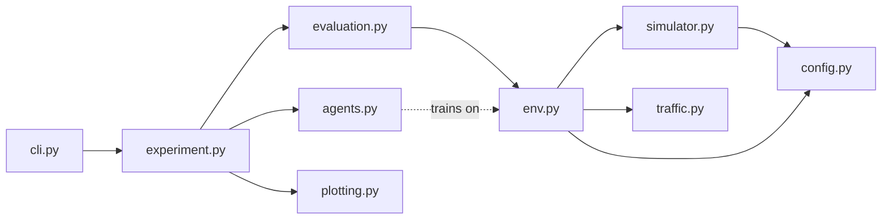

# Design

This document explains how `drxgym` is put together, the modeling assumptions behind it, and the engineering decisions that keep the results trustworthy.

## Architecture

Dependencies point one way, from the user-facing layer down to the physics. The simulator knows nothing about RL, and the RL environment knows nothing about how results are reported. That separation is what makes each layer unit-testable on its own.

| Module | Responsibility |
|---|---|
| `config.py` | Immutable dataclasses: power model, radio timing, DRX config, action grid |
| `traffic.py` | Stateful packet sources (IoT, VoIP, web, video, gaming) and a Markov-switching scenario |
| `simulator.py` | Event-driven DRX state machine; returns energy, latencies, and time spent per state |
| `env.py` | Gymnasium wrapper: observation features, reward, episode bookkeeping |
| `agents.py` | Policy interface, fixed and heuristic baselines, tabular Q-learning |
| `evaluation.py` | Paired evaluation on identical traffic traces, per-profile breakdowns |
| `experiment.py` | Train, evaluate, write `results.json`, `results.md`, and figures |
| `plotting.py` | Matplotlib figures for the report |
| `cli.py` | `drxgym experiment` and `drxgym inspect` |

## Simulation model

### UE behavior

1. **Awake.** After receiving data, the UE stays awake for `inactivity_ms`, monitoring the control channel (PDCCH). Packets are served FIFO; each one restarts the timer.
2. **DRX.** When the timer expires, a DRX cycle starts, anchored at that instant. Every `cycle_ms` the UE wakes, performs a **beam search** of `beam_search_ms` (mmWave only), then monitors for `on_duration_ms`.
3. **Sleep.** Between on-durations the UE sleeps in whichever sleep state (micro, light, deep) is cheapest for that gap length, accounting for each state's transition time and energy.
4. **Buffering.** A packet arriving while the UE sleeps waits at the base station until the next open on-duration, after beam search. This delay is the latency price of saving energy.

The beam-search term is what distinguishes mmWave (FR2) from sub-6 GHz (FR1): every wake-up has a fixed overhead, so short cycles become much more expensive.

### Power model

Relative power units in the style of the 3GPP Rel-16 UE power-saving study (TR 38.840): deep sleep = 1, light sleep = 20, micro sleep = 45, PDCCH monitoring = 100, data reception = 300. Beam search is set to 150, an assumption of this project rather than a 3GPP value. Results are reported as energy saving relative to "DRX disabled", so the absolute scale cancels out.

### Traffic

| Profile | Model | Latency budget |
|---|---|---|
| iot | Poisson, 0.2 packets/s | 2000 ms |
| voip | 20 ms packets in talk spurts (mean 2 s), silences (mean 1.5 s) | 50 ms |
| web | Bursts of ~25 packets after exponential reading time (mean 4 s) | 150 ms |
| video | 60-packet chunk roughly every 2 s | 400 ms |
| gaming | Poisson, 30 packets/s | 40 ms |

The active profile switches as a Markov chain (mean 8 windows per profile). This non-stationarity is the reason an adaptive controller can beat any fixed config.

### Decision problem

* **Step:** one 1-second window. The agent is a base-station-side controller that reconfigures the UE's DRX parameters once per window.
* **Action:** one of 20 (inactivity timer, cycle length) pairs: inactivity in {10, 50, 100, 200} ms, cycle in {20, 40, 80, 160, 320} ms.
* **Observation:** statistics of the previous window (packet count, inter-arrival burstiness, burst fraction, longest gap, violation rate, awake fraction) plus two slow exponential averages (recent activity, recent periodicity).
* **Reward:** `-(energy / energy_if_always_awake) - lambda * violation_rate`. Lambda sets how much one percent of late packets is worth in energy.

## Engineering decisions

**Event-driven simulation.** The simulator jumps between packet arrivals and cycle boundaries rather than iterating over every millisecond. One 60-second episode simulates in roughly 10 to 20 milliseconds, which makes 5000-episode training runs take under two minutes on a laptop.

**A conservation invariant as the core test.** Every millisecond of every window must be assigned to exactly one state (awake, sleeping, or beam search). The test runs across all 21 configs and 5 traffic profiles. It caught a real bug during development: a packet served in an on-duration that began in the *previous* window had its beam search counted twice. That case now has its own regression test.

**Paired, held-out evaluation.** Traffic is drawn from a separate random stream seeded per episode, so for a given seed every policy faces the identical packet trace. Differences between policies are therefore due to the policy, not traffic luck. Evaluation seeds start at 1,000,000 and never overlap training seeds.

**A deliberately strong static baseline.** `best_static` is the fixed config with the best return *on the evaluation traces themselves*. That is an unfair advantage for the baseline, chosen on purpose: beating it is a meaningful result.

**Tabular Q-learning, on purpose.** A neural network would scale to richer observations, but a table is fully inspectable. `drxgym inspect` prints which config the agent picks in each traffic state, and the policy map figure shows the choice per traffic profile, so a reviewer can sanity-check the learned behavior against wireless intuition.

**One policy interface.** Every controller implements `act(obs) -> int` (a `typing.Protocol`). The evaluation harness does not know or care whether a policy was learned or hand-written, which keeps comparisons uniform and makes new policies (DQN, PPO) drop-in.

**Reproducibility.** Every run is fully determined by its seed. `results.json` records the full experiment config alongside the metrics.

## Testing strategy

| Layer | What is tested |
|---|---|
| Power model | Sleep is always cheaper than staying awake; the cheapest feasible state is chosen |
| Simulator | Hand-computed latencies for known cases; FIFO queueing; backlog carried across windows; time conservation for every config and profile; reconfiguration mid-episode |
| Traffic | Sorted, in-window arrivals; same seed gives the same trace; rate sanity checks |
| Environment | Passes the official Gymnasium `check_env`; determinism; observation bounds |
| Agents | Q-learning improves over its own early episodes; save/load round-trip; history features separate a paused call from an idle device |
| Pipeline | The real CLI runs end to end and writes every artifact |

143 tests, 99% line coverage, run in CI on Python 3.10, 3.11, and 3.12 together with ruff and a smoke run of the full pipeline.

## Known limitations

* Single long DRX cycle; no short cycle, no wake-up signal (WUS), no PDCCH skipping.
* Beam search is a fixed overhead, not a function of mobility or beam count.
* One UE, no contention, no channel-quality variation.
* Synthetic traffic models rather than real traces.
* Energy is reported in relative units, not millijoules.

## Extension points

* **New traffic:** subclass `TrafficSource`, implement `_extend`, register it in `PROFILES`.
* **New policy:** any object with `name` and `act(obs) -> int`.
* **New radio:** pass a different `RadioConfig` (for example, mobility-dependent beam search time).
* **Deep RL:** the environment is standard Gymnasium, so Stable-Baselines3 DQN or PPO can train on it unchanged.
